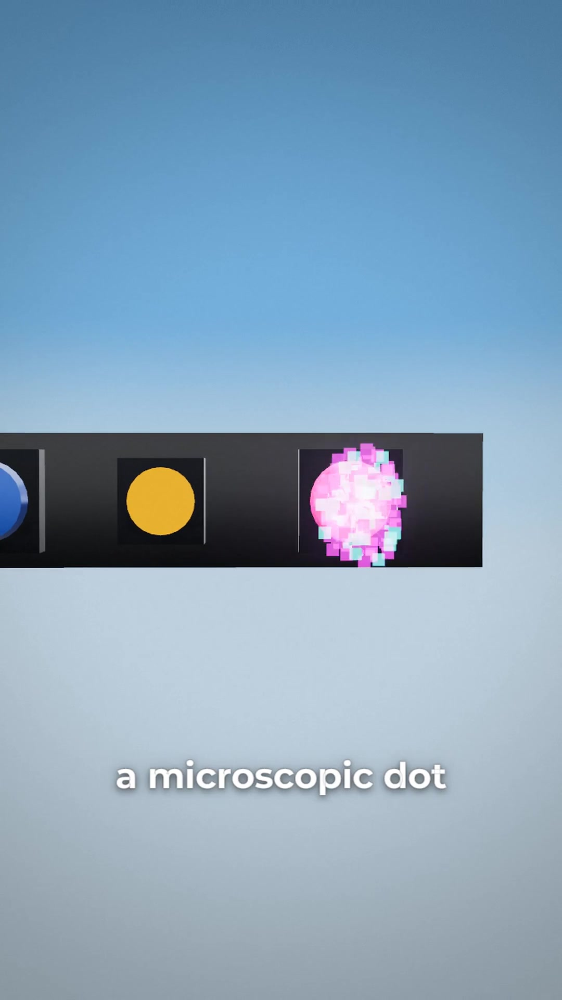
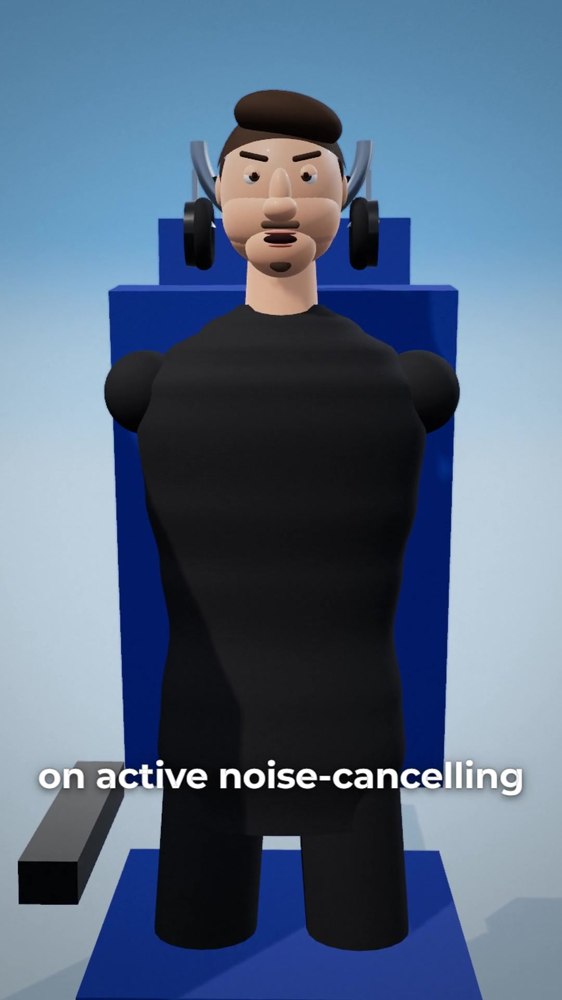
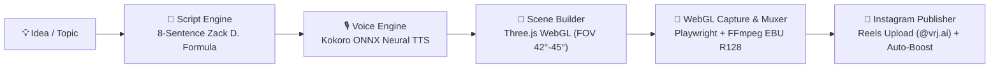

<div align="center">

# 🎬 Zack D. Films 3D Explainer & Instagram Auto-Publisher

**Autonomous 9:16 Vertical 3D Explainer Shorts with Three.js WebGL, Kokoro Neural Speech & Automated Instagram Reels Growth**

[](https://www.instagram.com/vrj.ai/)
[](https://threejs.org/)
[](https://playwright.dev/)
[](https://ffmpeg.org/)
[](https://python.org/)
[](LICENSE)

<br/>

> **Topic in → Broadcast-Quality 3D Explainer Reel out.**  
> Automatically transforms any question or tech topic into a broadcast 3D procedural explainer short in the signature **Zack D. Films** style, complete with neural voice acting, word timestamps, kinetic bounce typography, zoomed-out 9:16 framing, and automated Instagram publishing with algorithmic boost.

</div>

---

## 📺 Live Video Showcases (Generated & Published)

Click any card below to watch the generated 3D explainer reels live on Instagram:

| 📱 How Face ID Actually Works | 🛰️ How GPS Pinpoints Your Phone | 🎧 How Noise-Cancelling Works |
| :---: | :---: | :---: |
| [](https://www.instagram.com/reel/DfURj8es72J/) | [](https://www.instagram.com/reel/DfUTwgAscc8/) | [](https://www.instagram.com/vrj.ai/) |
| **[▶️ Watch on Instagram (40.8s)](https://www.instagram.com/reel/DfURj8es72J/)** | **[▶️ Watch on Instagram (42.2s)](https://www.instagram.com/reel/DfUTwgAscc8/)** | **[▶️ Watch on Instagram (1,470+ Views)](https://www.instagram.com/vrj.ai/)** |
| *Dot projector mesh, infrared scan & neural flood illuminator* | *Satellite atomic clocks, 20,000km trilateration & relativity* | *Phase-inverted counter soundwaves & acoustic cancellation* |

---

## ⚡ Quickstart (1-Click Setup)

Anyone — or AI coding assistants like **Claude Code**, **Antigravity**, **Cursor**, or **Codex** — can clone and run this repository in under 2 minutes:

```bash
# 1. Clone the repository
git clone https://github.com/VG31OP/2D-video-generator.git
cd 2D-video-generator

# 2. Run 1-Click Environment Setup
# Windows:
setup.bat
# macOS / Linux:
chmod +x setup.sh && ./setup.sh
```

### 🎬 Generate Your First Reel

```bash
# Generate a 3D explainer video locally (no upload):
python main.py "How Solar Panels Actually Work" --no-publish

# Generate and publish directly to Instagram Reels (@vrj.ai):
python main.py "Why We Dream When Sleeping" --publish

# Save to local drafts vault:
python main.py "How Touchscreens Detect Your Fingers" --draft

# Check Instagram account status & profile metrics:
python main.py --status
```

---

## 🔄 End-to-End Autonomous Pipeline



1. **Viral 8-Sentence Scripting**: Structured into *Hook → Misconception → Twist with dip to black → 4-Step Physical/Microscopic Mechanism → Surprise Payoff*.
2. **Neural Speech & Kinetic Captions**: Studio speech with Kokoro ONNX (`am_michael` 1.12x) or Edge-TTS fallback. Subtitles bounce with 1-to-3 words per flash, safely above `MarginV = 440`.
3. **Procedural 3D WebGL Engine**: Three.js WebGL procedural scenes with ACES Filmic tone mapping, Bokeh depth of field, and Apple Fluid camera easing.
4. **Comfortable Zoomed-Out Framing (Mandatory)**: Wide vertical 9:16 framing (**FOV 42°–45°, camera pullback Z=1.6m–2.4m**) ensures character arms, heads, and props are never cut off by vertical phone edges.
5. **Broadcast Muxing**: Master 1080x1920 MP4 with EBU R128 loudness normalization (`-14 LUFS, -1.5 dBFS True Peak, 48kHz AAC`).
6. **Instagram Auto-Publish & Growth**: Uploads to Reels, self-likes, posts a pinned CTA discussion comment, and reshares the reel to Instagram Stories.

---

## 🤖 For AI Coding Assistants (Claude Code, Antigravity, Cursor, Codex)

This repository is pre-configured with [`CLAUDE.md`](file:///e:/Project/ai%20video%20auto/CLAUDE.md) and [`AGENTS.md`](file:///e:/Project/ai%20video%20auto/AGENTS.md). You can prompt your assistant naturally:

> **"Make a 3D reel on How Airplane Autopilot Works and publish it to my Instagram"**

The assistant will:
1. Verify the setup (`python setup.py`).
2. Run `python main.py "How Airplane Autopilot Works" --publish`.
3. Interactively handle Instagram credentials on first run and store them securely in `storage/instagram_session.json` (git-ignored).
4. Return the live Instagram Reel URL.

---

## 🏛️ Project Structure

```
├── main.py                     # Primary CLI entrypoint (Topic -> 3D Video -> Instagram)
├── setup.py                    # Automated cross-platform environment installer
├── setup.bat / setup.sh        # OS one-click setup scripts
├── requirements.txt            # Clean, pinned Python dependencies
├── CLAUDE.md                   # Full guidelines for Claude Code, Antigravity, and Codex
├── AGENTS.md                   # Operational contracts, camera framing, and safety rules
│
├── core/                       # Autonomous Core Engine Package
│   ├── config.py               # Dynamic path resolution (FFmpeg, Chromium, Models)
│   ├── script_engine.py        # 8-sentence viral Zack D. formula with domain libraries
│   ├── voice_engine.py         # Kokoro ONNX + Edge-TTS fallback + word timestamps
│   ├── scene_builder.py        # Three.js 3D WebGL scene generator with zoomed-out framing
│   ├── renderer.py             # Playwright WebGL frame capture + FFmpeg EBU R128 muxer
│   ├── instagram.py            # Instagrapi client: login prompt, Reel upload, auto-boost
│   ├── pipeline.py             # Master orchestrator class connecting all modules
│   └── __init__.py             # Module exports
│
├── templates/zach_engine/      # Bundled Three.js WebGL engine template
│   ├── render.mjs              # Playwright headless WebGL frame capturer
│   ├── index.html              # WebGL canvas and shader setup
│   └── src/                    # Materials, human rig, props, camera easing curves
│
├── scripts/                    # Reusable system tools & analytics
│   ├── create_and_publish_zach_reel.py  # Standalone CLI wrapper
│   ├── instagram_manager.py             # Instagram CLI (status, upload, comments, story)
│   ├── profile_analytics.py             # Account performance & viewer analytics
│   └── publish_draft.py                 # Publish existing drafts
│
└── storage/                    # Local runtime storage (ALL git-ignored)
    ├── reels/                  # Generated video projects (storage/reels/zach_<slug>/)
    ├── drafts/                 # Stored drafts
    └── models/                 # Neural TTS weights (kokoro-v1.0.onnx)
```

---

## 📋 CLI Options Reference

```bash
python main.py [TOPIC] [OPTIONS]
```

| Flag | Description |
| :--- | :--- |
| `topic` | Title or topic for the explainer reel (e.g. `"How OLED Screens Burn In"`). |
| `--publish` | Uploads directly to Instagram Reels and executes automated engagement boost. |
| `--no-publish` | Renders the master 1080x1920 MP4 locally without uploading. |
| `--draft` | Saves master MP4 and JSON metadata into `storage/drafts/` for offline review. |
| `--status` | Displays connected Instagram profile handle, follower count, and total reels. |
| `--script-file <path>` | Uses a custom 8-sentence JSON script instead of auto-generating one. |
| `--username <user>` | Instagram username for direct authentication. |
| `--password <pass>` | Instagram password for direct authentication. |
| `--session-id <id>` | Instagram `sessionid` browser cookie for direct authentication. |

---

## 🔒 Security & Git Hygiene Rules

- **Zero Media in Git**: All `.mp4`, `.wav`, `.onnx`, `.bin`, `.db`, and `.json` session files remain in `storage/` and are strictly ignored via `.gitignore`.
- **Zero One-Off Scripts**: Per-video throwaway scripts are forbidden in `scripts/`. All video generation runs through `main.py` or `core.pipeline`.
- **Cross-Platform Compatibility**: Tested and verified on Windows 11, macOS, and Linux.

---

<div align="center">
  <sub>Built for Autonomous Content Creators & AI Coding Agents. Star ⭐ this repository if you find it helpful!</sub>
</div>
